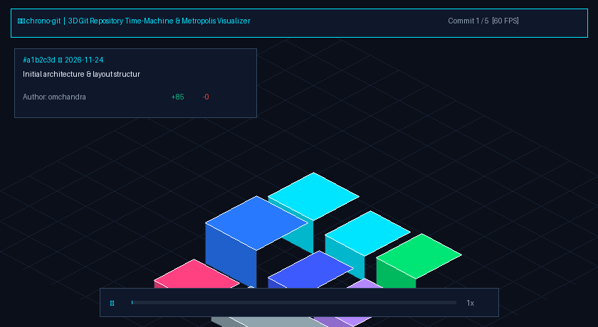

# chrono-git

> 3D Git repository time-machine and codebase metropolis visualizer built with TypeScript, Three.js, and squarified treemaps.



[](https://github.com/omchandra0907-jpg/chrono-git/actions/workflows/ci.yml)
[](https://opensource.org/licenses/MIT)
[](https://www.typescriptlang.org/)

> **Live Interactive Web Demo:** [https://omchandra0907-jpg.github.io/chrono-git/](https://omchandra0907-jpg.github.io/chrono-git/)

---

## Architecture & Data Structures

- **Squarified Treemap City Layout**: Converts hierarchical directory trees into 2D ground coordinates using a pure TypeScript squarified treemap engine (Bruls, Huizing, van Wijk). Ensures non-overlapping bounding boxes, optimal near-unity aspect ratios, and strict area conservation.
- **60 FPS GPU Instanced Rendering**: Renders all repository files within a single `THREE.InstancedMesh` rather than allocating separate Mesh draw-calls. Building height dynamically interpolates from $\log_2(\text{LinesOfCode} + 1)$.
- **Curated Neon Language Palette**:
  - `TypeScript / TSX`: Neon Cyan (`#00e5ff`)
  - `JavaScript / JSX`: Electric Yellow (`#ffd600`)
  - `C / C++`: Cobalt Blue (`#2979ff`)
  - `Python`: Emerald Green (`#00e676`)
  - `Rust`: Vivid Orange (`#ff6d00`)
  - `Markdown / Docs`: Lavender Purple (`#b388ff`)
  - `JSON / Config`: Hot Pink (`#ff4081`)
- **Decoupled Data Ingestion**:
  - **Local CLI Exporter:** Parse local repositories via `git log --numstat --reverse` into compact JSON format.
  - **In-Browser GitHub API Client:** Directly fetch public GitHub repository history on the fly.
- **Emissive Touch Decay Animation**: File buildings modified in recent commits pulse with neon luminescence that smoothly decays over subsequent commits.
- **Glassmorphic HUD & Controls**: Interactive timeline scrubber, variable playback speed (`0.5x` to `4x`), camera orbit damping, and click-to-focus building inspection.

---

## Quickstart

### Installation & Local Dev
```bash
git clone https://github.com/omchandra0907-jpg/chrono-git.git
cd chrono-git
npm install
npm run dev
```

### Production Build
```bash
npm run build
```

---

## Verification & Testing

Execute unit tests verifying squarified treemap layout math, area conservation, and commit log parsing:

```bash
npm test
```

---

## Technical Specifications

| Parameter | Specification |
|---|---|
| **Language** | TypeScript 5.3+ (Strict Mode) |
| **3D Rendering** | Three.js (WebGL) via `THREE.InstancedMesh` |
| **Layout Algorithm** | Squarified Treemap (Aspect ratio minimization $\approx 1.0$) |
| **Performance Target** | 60 FPS for codebases up to 10,000+ files |
| **Build Tooling** | Vite 5.x + Vitest |

---

## License

Distributed under the MIT License. Developed by [Om Chandra](https://github.com/omchandra0907-jpg).
